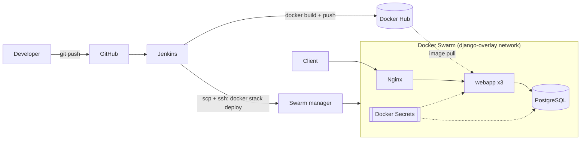

# django-devops-lab

A Django portfolio app used as a hands-on lab for containerization, Docker Swarm, Jenkins CI/CD, zero-downtime rolling updates, and Kubernetes (Helm, Argo CD, Istio).

## Overview

The application itself is intentionally small: a Django site with a landing page and a few JSON endpoints. The value of the repository is the delivery pipeline around it. The same image is packaged with a multi-stage Dockerfile and then run in three ways:

1. **Docker Compose** for local development (Django + PostgreSQL + Nginx).
2. **Docker Swarm** for a replicated, rolling-update deployment driven by a **Jenkins** pipeline.
3. **Kubernetes** with plain manifests, a Helm chart, and an Argo CD `Application` for GitOps-style sync.

A separate `socket-app/` experiment tests long-lived WebSocket connections through an Istio ingress gateway.

## What it demonstrates

**Containers**
- Multi-stage `Dockerfile`: a Node (Alpine) stage for the frontend build, a Python (Alpine) stage that builds wheels, and a slim runtime stage that installs only the prebuilt wheels.
- Runtime container runs as a non-root `django` user and serves the app with Gunicorn.

**Docker Swarm** (`docker-stack.yml`)
- `webapp` service with 3 replicas and `max_replicas_per_node: 2`.
- Rolling updates: `parallelism: 1`, `delay: 10s`, `order: start-first`, `monitor: 30s`, `failure_action: rollback`.
- PostgreSQL service with a `pg_isready` healthcheck and a named volume.
- Docker Secrets for the database password and Django secret key, read from `/run/secrets/` (see `get_secret` in `core/settings.py`; environment variables are used as a fallback outside Swarm).
- Pre-created external overlay network (`django-overlay`) and an Nginx service whose config is delivered as a Swarm config.

**Jenkins CI/CD** (`Jenkinsfile`)
- Declarative pipeline: Checkout, Build, Push, Deploy to Swarm.
- Images tagged `v1.0.<BUILD_NUMBER>` and `latest`.
- Docker Hub credentials come from the Jenkins credentials store (`withCredentials`) and are passed via `--password-stdin`.
- Deployment copies `docker-stack.yml` to the Swarm manager over SSH and runs `docker stack deploy`.

**Kubernetes**
- `k8s/`: Deployment, NodePort Service, PostgreSQL Deployment/Service, ConfigMap and Secret, an NGINX Ingress with a cert-manager self-signed `ClusterIssuer`, and an Ingress for Argo CD.
- `django-chart/`: Helm chart (Deployment, Service, Ingress, PostgreSQL, HPA, resource requests/limits).
- `k8s/argo-application.yml`: Argo CD `Application` pulling the chart from a Helm repository, with automated sync, prune and self-heal.
- Liveness and readiness probes on the Django Deployment.

**Istio WebSocket test** (`socket-app/`)
- A small `websockets` ping/pong server and client, with an Istio `Gateway`/`VirtualService` exposing raw TCP on port 8765 and an `EnvoyFilter` that sets a 30-minute TCP idle timeout. Used to check that a connection stays open for 10+ minutes.

## Architecture



## Tech stack

| Area | Tools |
| --- | --- |
| Application | Python 3.11, Django 5.2, Gunicorn, PostgreSQL 16 (SQLite fallback for local use) |
| Containers | Docker, multi-stage builds, Docker Compose, Alpine Linux |
| Orchestration | Docker Swarm (stack, secrets, configs, overlay network), Kubernetes, Helm |
| CI/CD / GitOps | Jenkins (declarative pipeline), Argo CD |
| Web / proxy | Nginx, NGINX Ingress, cert-manager (self-signed issuer), Istio |
| Testing | Siege (load test), Python WebSocket client |

## Project structure

```text
.
├── core/                  # Django project; settings with Docker Secret resolver
├── templates/, static/    # Portfolio page
├── frontend/              # Minimal frontend build stub used by the Dockerfile
├── nginx/                 # Nginx reverse-proxy config
├── Dockerfile             # Multi-stage image
├── docker-compose.yml     # Local development stack
├── docker-stack.yml       # Swarm stack (replicas, rolling update, secrets)
├── Jenkinsfile            # CI/CD pipeline
├── k8s/                   # Plain Kubernetes manifests + Argo CD Application
├── django-chart/          # Helm chart
├── socket-app/            # WebSocket ping/pong + Istio TCP gateway experiment
└── .env.example           # Environment variable template
```

## Getting started

### Local development with Docker Compose

```bash
cp .env.example .env     # fill in the empty values
docker compose up --build -d
```

The site is served through Nginx on port 80. The `web` container runs `migrate` and `collectstatic` before starting Gunicorn.

### Docker Swarm

The stack expects a few resources to exist first (names come from `docker-stack.yml`):

```bash
docker swarm init
docker network create --driver overlay django-overlay
printf '<db-password>'   | docker secret create db_password -
printf '<django-secret>' | docker secret create django_secret_key -
docker stack deploy -c docker-stack.yml my-django-stack
```

The database service is pinned to a node with the hostname `swarm-manager`; adjust the placement constraint for your cluster. The `webapp` image (`ayqutfe/django-multistage`) is pulled from Docker Hub.

### Jenkins pipeline

Create a pipeline job from SCM that uses the `Jenkinsfile`, add a `docker-hub-credentials` username/password credential, and give the Jenkins user SSH access to the Swarm manager. Set `SWARM_MANAGER_IP` and `SWARM_MANAGER_USER` in the `environment` block to match your environment.

### Kubernetes

```bash
kubectl apply -f k8s/postgres-config.yml -f k8s/postgres-secret.yml \
              -f k8s/postgres-deployment.yml -f k8s/postgres-service.yml \
              -f k8s/django-deployment.yml -f k8s/django-service.yml
```

Replace the sample values in `k8s/postgres-secret.yml` before using it anywhere other than a throwaway cluster. For the Helm route, `helm install django-app ./django-chart` installs the chart from this directory.

### Zero-downtime check with Siege

Run a load test from outside the cluster while a new image is being deployed:

```bash
siege -c 10 -t 30s http://<swarm-public-address>/
```

A passing run shows 100% availability and 0 failed transactions.

## Notes

- The `/api/health/` and `/api/siege-simulate/` endpoints return static demo data for the portfolio page; they do not report live cluster metrics.
- In `docker-stack.yml` the `webapp` healthcheck is present but commented out; rolling updates currently rely on `monitor: 30s` with `failure_action: rollback`.
